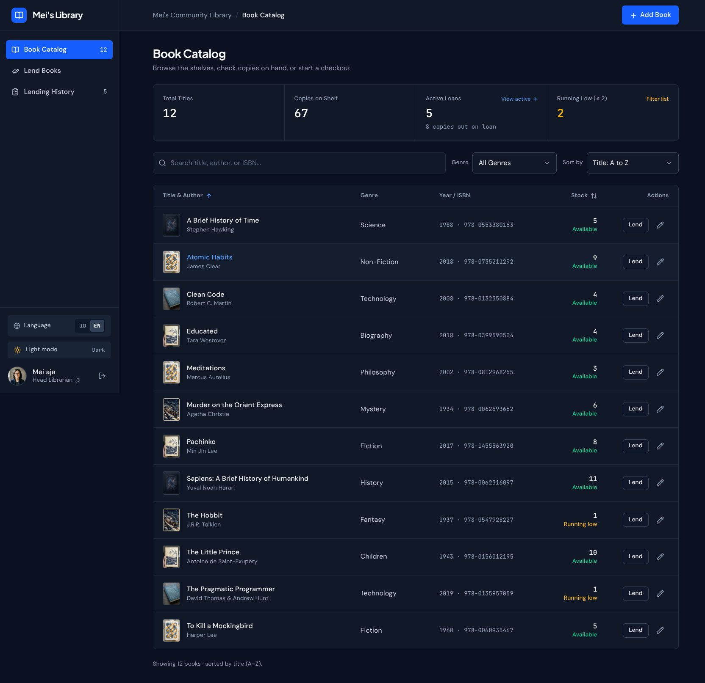
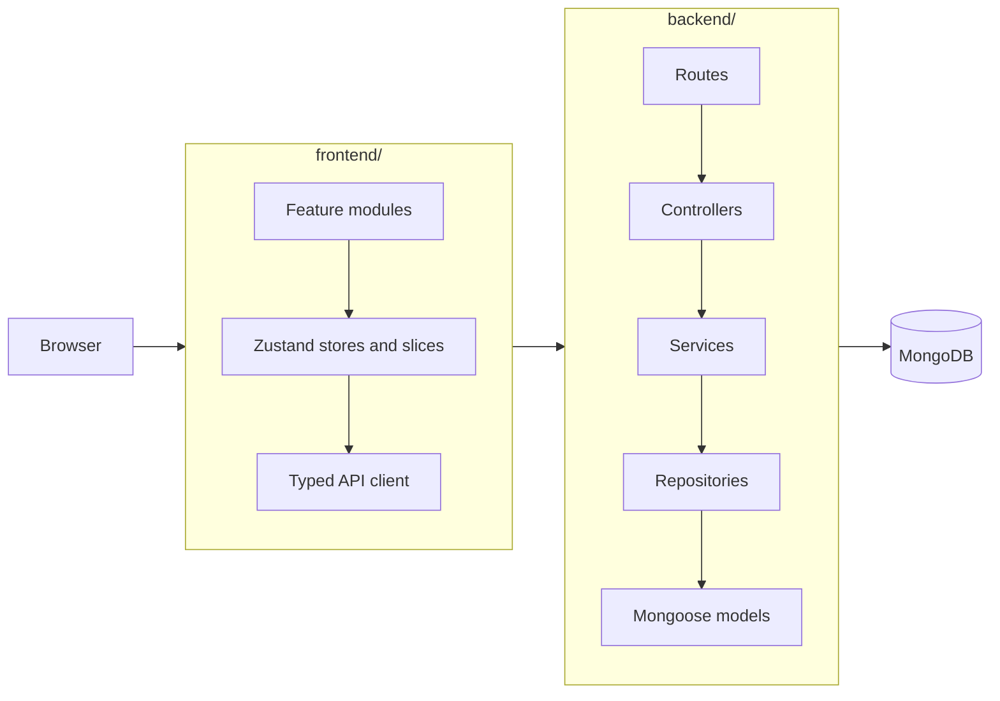
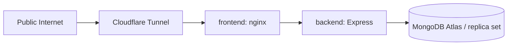

# Mei's Community Library

> Demo: [library.bagos.web.id](https://library.bagos.web.id) · Password: `password123`



A full-stack library inventory and lending application. It provides a secured catalog, multi-book checkout workflow, lending history, bilingual UI, and a production Docker deployment path.

| Layer       | Stack                                                |
| ----------- | ---------------------------------------------------- |
| Web client  | React 19, Zustand 5, Motion, Tailwind CSS 4, Vite 8  |
| API         | Express 4, TypeScript, Mongoose 9                    |
| Persistence | MongoDB replica set or MongoDB Atlas                 |
| Runtime     | Node.js 22, Docker Compose, nginx, Cloudflare Tunnel |

## Capabilities

- Catalog search, genre and stock filtering, sorting, book detail, creation, editing, and deletion.
- Optimistic stock editing guarded by `expectedStock`, so a conflicting update returns `409` instead of overwriting another change.
- Multi-book lending with a review step that shows stock before/after confirmation.
- Atomic lending and return transactions: stock and lending history change together or not at all.
- Lending history with active/returned filters, borrower search, overdue status, and return actions.
- First-admin setup, password login, short-lived access tokens, rotating refresh cookies, rate limits, CSRF protections, and logout/password-session revocation.
- English and Indonesian localization, light/dark themes, keyboard-accessible modals, selects, and date picker.

## Architecture

```mermaid
flowchart LR
  browser["Browser"] --> frontend["React client"]
    frontend --> api["Express API"]
      api --> mongo[("MongoDB")]
      
        subgraph frontend["frontend/"]
            features["Feature modules"]
                state["Zustand stores and slices"]
                    client["Typed API client"]
                        features --> state --> client
                          end
                          
                            subgraph api["backend/"]
                                routes["Routes"] --> controllers["Controllers"]
                                    controllers --> services["Services"] --> repositories["Repositories"]
                                        repositories --> models["Mongoose models"]
                                          end
                                          ```
                                          
                                          The shared domain contract lives in [`shared/library.ts`](shared/library.ts). Both the backend and frontend import this contract; neither copies API DTOs or cover-image validation rules.
                                          
                                          For request flows, data models, authentication headers, payload examples, and the full REST contract, see [`docs/system-contract.md`](docs/system-contract.md). For deployment, Docker hardening, health checks, operations, and troubleshooting, see [`docs/operations.md`](docs/operations.md).
                                          
                                          ## Repository layout
                                          
                                          ```text
                                          .
                                          ├── backend/
                                          │   ├── Dockerfile
                                          │   └── src/
                                          │       ├── app.ts                    # Express app composition
                                          │       ├── index.ts                  # HTTP server and lifecycle
                                          │       ├── config/                   # database, proxy, static hosting, shutdown
                                          │       ├── controllers/              # auth, books, lending, health handlers
                                          │       ├── data/                     # explicit development seed data
                                          │       ├── errors/                   # typed API errors
                                          │       ├── middleware/               # auth, CSRF, DB, errors, headers
                                          │       ├── models/                   # Mongoose schemas
                                          │       ├── repositories/             # MongoDB and local data adapters
                                          │       ├── routes/                   # API route composition
                                          │       ├── services/                 # auth, books, lending business rules
                                          │       ├── utils/                    # crypto, HTTP and validation primitives
                                          │       ├── validators/               # trust-boundary input validation
                                          │       └── tests/                    # backend service coverage
                                          ├── frontend/
                                          │   ├── Dockerfile
                                          │   ├── nginx.conf
                                          │   ├── nginx-security-headers.conf
                                          │   ├── public/                       # icons and pre-paint theme bootstrap
                                          │   └── src/
                                          │       ├── components/
                                          │       │   ├── layout/               # sidebar, mobile navigation, toggles, toasts
                                          │       │   └── ui/                   # reusable accessible controls and modal primitives
                                          │       ├── config/                   # assets and navigation metadata
                                          │       ├── features/
                                          │       │   ├── auth/                 # sign-in, setup, password update
                                          │       │   ├── catalog/              # inventory, book forms, details, deletion
                                          │       │   ├── lending/              # checkout draft, summary, shelf picker
                                          │       │   └── history/              # lending records and returns
                                          │       ├── hooks/                    # theme, local-date and popover behaviour
                                          │       ├── i18n/                     # typed English and Indonesian dictionaries
                                          │       ├── services/                 # typed API/refresh client
                                          │       ├── store/                    # auth, locale, toast and catalog/lending/history slices
                                          │       └── utils/                    # pure calendar, catalog/lending and image utilities
                                          ├── shared/
                                          │   └── library.ts                    # domain types, constants and cover validation
                                          ├── docs/
                                          │   ├── operations.md                 # deployment and operating guide
                                          │   └── system-contract.md            # diagrams and API contract
                                          ├── docker-compose.yml
                                          ├── package.json
                                          └── tsconfig.json
                                          ```
                                          
                                          ## Local development
                                          
                                          ### Prerequisites
                                          
                                          - Node.js 22 or later and npm.
                                          - A MongoDB 7+ replica set, including for local development. Lending and return operations require transactions.
                                          
                                          ### Install and configure
                                          
                                          ```bash
                                          npm ci
                                          cp .env.example .env
                                          ```
                                          
                                          Set at least these local values in `.env`:
                                          
                                          ```dotenv
                                          MONGODB_URI="mongodb://127.0.0.1:27017/meis_community_library?replicaSet=rs0"
                                          PORT=3000
                                          NODE_ENV=development
                                          ```
                                          
                                          `.env.example` documents every supported variable. Keep `.env` private; it is intentionally ignored by Git and Docker build contexts.
                                          
                                          ### Run
                                          
                                          ```bash
                                          npm run dev
                                          ```
                                          
                                          The development server starts the Express API and Vite middleware together. By default it listens at `http://localhost:3000`.
                                          
                                          Seed only when sample data is wanted:
                                          
                                          ```bash
                                          npm run seed
                                          npm run seed -- --reset # destructive: clears catalog and lending data first
                                          ```
                                          
                                          ## Quality checks
                                          
                                          ```bash
                                          npm run format:check
                                          npm run lint
                                          npm run typecheck
                                          npm test
                                          npm run build
                                          ```
                                          
                                          The test command discovers backend tests plus recursively nested frontend tests. Three MongoDB integration tests are skipped unless both disposable test targets are supplied:
                                          
                                          ```bash
                                          MONGODB_TEST_URI="mongodb://..." \
                                          MONGODB_STANDALONE_TEST_URI="mongodb://..." \
                                          npm test
                                          ```
                                          
                                          | Script                            | Purpose                                                                     |
                                          | --------------------------------- | --------------------------------------------------------------------------- |
                                          | `npm run dev`                     | Express plus Vite development server                                        |
                                          | `npm start`                       | Production Express server; requires a built frontend unless `API_ONLY=true` |
                                          | `npm run build`                   | Build `frontend/dist` with Vite                                             |
                                          | `npm run preview`                 | Preview the built frontend through Vite                                     |
                                          | `npm run seed [-- --reset]`       | Insert sample data; `--reset` is destructive                                |
                                          | `npm test`                        | Run Node tests through `tsx`                                                |
                                          | `npm run typecheck`               | Type-check without emitting files                                           |
                                          | `npm run lint` / `lint:fix`       | Run ESLint / apply ESLint fixes                                             |
                                          | `npm run format` / `format:check` | Format / verify formatting with Prettier                                    |
                                          | `npm run clean`                   | Remove generated build output                                               |
                                          
                                          ## Docker Compose deployment
                                          
                                          The Compose stack uses three services:
                                          
                                          ```mermaid
                                          flowchart LR
                                            internet["Public Internet"] --> cloudflare["Cloudflare Tunnel"]
                                              cloudflare --> nginx["frontend: nginx"]
                                                nginx --> backend["backend: Express"]
                                                  backend --> atlas[("MongoDB Atlas / replica set")]
                                                  ```
                                                  
                                                  No service publishes a host port. The tunnel connects outbound to Cloudflare, nginx proxies `/api/` to the backend, and the backend uses an egress-only network to reach MongoDB.
                                                  
                                                  1. Create production `.env` from `.env.example`.
                                                  2. Set `MONGODB_URI`, `TUNNEL_TOKEN`, and a stable `JWT_SECRET` of at least 32 UTF-8 bytes.
                                                  3. Generate a `SETUP_TOKEN` of at least 32 characters for initial setup.
                                                  4. Start the stack:
                                                  
                                                     ```bash
                                                        docker compose up --build -d
                                                           docker compose ps
                                                              ```
                                                              
                                                              5. Create the first administrator from the same site origin:
                                                              
                                                                 ```bash
                                                                    curl -X POST https://library.example.com/api/auth/setup \
                                                                         -H 'Content-Type: application/json' \
                                                                              -H 'X-Requested-With: XMLHttpRequest' \
                                                                                   -H "X-Setup-Token: $SETUP_TOKEN" \
                                                                                        --data '{"name":"Librarian","email":"librarian@example.com","password":"replace-with-a-strong-password"}'
                                                                                           ```
                                                                                           
                                                                                           6. Remove `SETUP_TOKEN` and recreate the backend:
                                                                                           
                                                                                              ```bash
                                                                                                 docker compose up -d backend
                                                                                                    ```
                                                                                                    
                                                                                                    `GET /api/health` returns `200` only when MongoDB is connected and `503` otherwise. Compose uses it to determine backend readiness.
                                                                                                    
                                                                                                    ### Production security model
                                                                                                    
                                                                                                    - The frontend nginx layer sends the backend one trusted client-IP chain and the HTTPS scheme from Cloudflare.
                                                                                                    - `TRUST_PROXY` must match the nginx fixed address on the internal backend network. See the topology section of [`docs/operations.md`](docs/operations.md).
                                                                                                    - nginx serves CSP, HSTS, frame, MIME, referrer, and permissions policies.
                                                                                                    - Runtime containers are read-only, drop Linux capabilities, disallow privilege escalation, and use bounded logs and resource limits.
                                                                                                    - MongoDB Atlas should allowlist the deployment's egress IP, not `0.0.0.0/0`.
                                                                                                    
                                                                                                    ## Security and secrets
                                                                                                    
                                                                                                    Never commit `.env`, database URIs, tunnel tokens, JWT secrets, setup tokens, service-account credentials, or generated build output. Before publishing or deploying, run:
                                                                                                    
                                                                                                    ```bash
                                                                                                    git status --short
                                                                                                    npm run format:check && npm run lint && npm run typecheck && npm test && npm run build
                                                                                                    ```
                                                                                                    
                                                                                                    Rotate a secret immediately if it was placed in a terminal transcript, issue tracker, commit, screenshot, or public channel. The full secret rotation checklist is in [`docs/operations.md#9-secrets-and-rotation`](docs/operations.md#9-secrets-and-rotation).
                                                                                                    
                                                                                                    ## Feature module conventions
                                                                                                    
                                                                                                    A feature owns its screen, domain components, modal(s), feature-only hooks, and focused tests. Shared reusable controls belong in `components/ui`; cross-feature layout belongs in `components/layout`; domain-neutral contracts belong in `shared/`.
                                                                                                    
                                                                                                    When adding a feature:
                                                                                                    
                                                                                                    1. Put feature-local UI and tests in `frontend/src/features/<feature>/`.
                                                                                                    2. Put persistent cross-screen state in a focused Zustand slice or store; keep transient input state local.
                                                                                                    3. Reuse the typed API client and shared contracts rather than duplicating DTOs.
                                                                                                    4. Keep user-visible copy in `i18n/translations.ts` and retain English/Indonesian key parity.
                                                                                                    5. Add or update a meaningful regression test, then run the quality checks above.
                                                                                                    
                                                                                                    ## Operations and troubleshooting
                                                                                                    
                                                                                                    | Symptom                                         | First check                                                                                     |
                                                                                                    | ----------------------------------------------- | ----------------------------------------------------------------------------------------------- |
                                                                                                    | API health returns `503`                        | Backend logs, `MONGODB_URI`, Atlas IP allowlist, and replica-set availability                   |
                                                                                                    | Lending reports transaction support is required | Use Atlas or configure a MongoDB replica set                                                    |
                                                                                                    | All login attempts share a rate limit           | Verify `TRUST_PROXY` still matches `FRONTEND_BACKEND_IP`                                        |
                                                                                                    | Setup returns `403`                             | Confirm production `SETUP_TOKEN` exists, is at least 32 characters, and matches `X-Setup-Token` |
                                                                                                    | Images or request payload are rejected          | Check nginx body limit and application validation errors                                        |
                                                                                                    
                                                                                                    The complete source-backed troubleshooting matrix is in [`docs/operations.md#13-troubleshooting`](docs/operations.md#13-troubleshooting).
                                                                                                    
                                                                                                    ## License
                                                                                                    
                                                                                                    No license has been selected yet. Add one before distributing the project outside the repository's authorized audience.| ----------- | ---------------------------------------------------- |
| Web client  | React 19, Zustand 5, Motion, Tailwind CSS 4, Vite 8  |
| API         | Express 4, TypeScript, Mongoose 9                    |
| Persistence | MongoDB replica set or MongoDB Atlas                 |
| Runtime     | Node.js 22, Docker Compose, nginx, Cloudflare Tunnel |

## Capabilities

- Catalog search, genre and stock filtering, sorting, book detail, creation, editing, and deletion.
- Optimistic stock editing guarded by `expectedStock`, so a conflicting update returns `409` instead of overwriting another change.
- Multi-book lending with a review step that shows stock before/after confirmation.
- Atomic lending and return transactions: stock and lending history change together or not at all.
- Lending history with active/returned filters, borrower search, overdue status, and return actions.
- First-admin setup, password login, short-lived access tokens, rotating refresh cookies, rate limits, CSRF protections, and logout/password-session revocation.
- English and Indonesian localization, light/dark themes, keyboard-accessible modals, selects, and date picker.

## Architecture



The shared domain contract lives in [`shared/library.ts`](shared/library.ts). Both the backend and frontend import this contract; neither copies API DTOs or cover-image validation rules.

For request flows, data models, authentication headers, payload examples, and the full REST contract, see [`docs/system-contract.md`](docs/system-contract.md). For deployment, Docker hardening, health checks, operations, and troubleshooting, see [`docs/operations.md`](docs/operations.md).

## Repository layout

```text
.
├── backend/
│   ├── Dockerfile
│   └── src/
│       ├── app.ts                    # Express app composition
│       ├── index.ts                  # HTTP server and lifecycle
│       ├── config/                   # database, proxy, static hosting, shutdown
│       ├── controllers/              # auth, books, lending, health handlers
│       ├── data/                     # explicit development seed data
│       ├── errors/                   # typed API errors
│       ├── middleware/               # auth, CSRF, DB, errors, headers
│       ├── models/                   # Mongoose schemas
│       ├── repositories/             # MongoDB and local data adapters
│       ├── routes/                   # API route composition
│       ├── services/                 # auth, books, lending business rules
│       ├── utils/                    # crypto, HTTP and validation primitives
│       ├── validators/               # trust-boundary input validation
│       └── tests/                    # backend service coverage
├── frontend/
│   ├── Dockerfile
│   ├── nginx.conf
│   ├── nginx-security-headers.conf
│   ├── public/                       # icons and pre-paint theme bootstrap
│   └── src/
│       ├── components/
│       │   ├── layout/               # sidebar, mobile navigation, toggles, toasts
│       │   └── ui/                   # reusable accessible controls and modal primitives
│       ├── config/                   # assets and navigation metadata
│       ├── features/
│       │   ├── auth/                 # sign-in, setup, password update
│       │   ├── catalog/              # inventory, book forms, details, deletion
│       │   ├── lending/              # checkout draft, summary, shelf picker
│       │   └── history/              # lending records and returns
│       ├── hooks/                    # theme, local-date and popover behaviour
│       ├── i18n/                     # typed English and Indonesian dictionaries
│       ├── services/                 # typed API/refresh client
│       ├── store/                    # auth, locale, toast and catalog/lending/history slices
│       └── utils/                    # pure calendar, catalog/lending and image utilities
├── shared/
│   └── library.ts                    # domain types, constants and cover validation
├── docs/
│   ├── operations.md                 # deployment and operating guide
│   └── system-contract.md            # diagrams and API contract
├── docker-compose.yml
├── package.json
└── tsconfig.json
```

## Local development

### Prerequisites

- Node.js 22 or later and npm.
- A MongoDB 7+ replica set, including for local development. Lending and return operations require transactions.

### Install and configure

```bash
npm ci
cp .env.example .env
```

Set at least these local values in `.env`:

```dotenv
MONGODB_URI="mongodb://127.0.0.1:27017/meis_community_library?replicaSet=rs0"
PORT=3000
NODE_ENV=development
```

`.env.example` documents every supported variable. Keep `.env` private; it is intentionally ignored by Git and Docker build contexts.

### Run

```bash
npm run dev
```

The development server starts the Express API and Vite middleware together. By default it listens at `http://localhost:3000`.

Seed only when sample data is wanted:

```bash
npm run seed
npm run seed -- --reset # destructive: clears catalog and lending data first
```

## Quality checks

```bash
npm run format:check
npm run lint
npm run typecheck
npm test
npm run build
```

The test command discovers backend tests plus recursively nested frontend tests. Three MongoDB integration tests are skipped unless both disposable test targets are supplied:

```bash
MONGODB_TEST_URI="mongodb://..." \
MONGODB_STANDALONE_TEST_URI="mongodb://..." \
npm test
```

| Script                            | Purpose                                                                     |
| --------------------------------- | --------------------------------------------------------------------------- |
| `npm run dev`                     | Express plus Vite development server                                        |
| `npm start`                       | Production Express server; requires a built frontend unless `API_ONLY=true` |
| `npm run build`                   | Build `frontend/dist` with Vite                                             |
| `npm run preview`                 | Preview the built frontend through Vite                                     |
| `npm run seed [-- --reset]`       | Insert sample data; `--reset` is destructive                                |
| `npm test`                        | Run Node tests through `tsx`                                                |
| `npm run typecheck`               | Type-check without emitting files                                           |
| `npm run lint` / `lint:fix`       | Run ESLint / apply ESLint fixes                                             |
| `npm run format` / `format:check` | Format / verify formatting with Prettier                                    |
| `npm run clean`                   | Remove generated build output                                               |

## Docker Compose deployment

The Compose stack uses three services:



No service publishes a host port. The tunnel connects outbound to Cloudflare, nginx proxies `/api/` to the backend, and the backend uses an egress-only network to reach MongoDB.

1. Create production `.env` from `.env.example`.
2. Set `MONGODB_URI`, `TUNNEL_TOKEN`, and a stable `JWT_SECRET` of at least 32 UTF-8 bytes.
3. Generate a `SETUP_TOKEN` of at least 32 characters for initial setup.
4. Start the stack:

   ```bash
   docker compose up --build -d
   docker compose ps
   ```

5. Create the first administrator from the same site origin:

   ```bash
   curl -X POST https://library.example.com/api/auth/setup \
     -H 'Content-Type: application/json' \
     -H 'X-Requested-With: XMLHttpRequest' \
     -H "X-Setup-Token: $SETUP_TOKEN" \
     --data '{"name":"Librarian","email":"librarian@example.com","password":"replace-with-a-strong-password"}'
   ```

6. Remove `SETUP_TOKEN` and recreate the backend:

   ```bash
   docker compose up -d backend
   ```

`GET /api/health` returns `200` only when MongoDB is connected and `503` otherwise. Compose uses it to determine backend readiness.

### Production security model

- The frontend nginx layer sends the backend one trusted client-IP chain and the HTTPS scheme from Cloudflare.
- `TRUST_PROXY` must match the nginx fixed address on the internal backend network. See the topology section of [`docs/operations.md`](docs/operations.md).
- nginx serves CSP, HSTS, frame, MIME, referrer, and permissions policies.
- Runtime containers are read-only, drop Linux capabilities, disallow privilege escalation, and use bounded logs and resource limits.
- MongoDB Atlas should allowlist the deployment's egress IP, not `0.0.0.0/0`.

## Security and secrets

Never commit `.env`, database URIs, tunnel tokens, JWT secrets, setup tokens, service-account credentials, or generated build output. Before publishing or deploying, run:

```bash
git status --short
npm run format:check && npm run lint && npm run typecheck && npm test && npm run build
```

Rotate a secret immediately if it was placed in a terminal transcript, issue tracker, commit, screenshot, or public channel. The full secret rotation checklist is in [`docs/operations.md#9-secrets-and-rotation`](docs/operations.md#9-secrets-and-rotation).

## Feature module conventions

A feature owns its screen, domain components, modal(s), feature-only hooks, and focused tests. Shared reusable controls belong in `components/ui`; cross-feature layout belongs in `components/layout`; domain-neutral contracts belong in `shared/`.

When adding a feature:

1. Put feature-local UI and tests in `frontend/src/features/<feature>/`.
2. Put persistent cross-screen state in a focused Zustand slice or store; keep transient input state local.
3. Reuse the typed API client and shared contracts rather than duplicating DTOs.
4. Keep user-visible copy in `i18n/translations.ts` and retain English/Indonesian key parity.
5. Add or update a meaningful regression test, then run the quality checks above.

## Operations and troubleshooting

| Symptom                                         | First check                                                                                     |
| ----------------------------------------------- | ----------------------------------------------------------------------------------------------- |
| API health returns `503`                        | Backend logs, `MONGODB_URI`, Atlas IP allowlist, and replica-set availability                   |
| Lending reports transaction support is required | Use Atlas or configure a MongoDB replica set                                                    |
| All login attempts share a rate limit           | Verify `TRUST_PROXY` still matches `FRONTEND_BACKEND_IP`                                        |
| Setup returns `403`                             | Confirm production `SETUP_TOKEN` exists, is at least 32 characters, and matches `X-Setup-Token` |
| Images or request payload are rejected          | Check nginx body limit and application validation errors                                        |

The complete source-backed troubleshooting matrix is in [`docs/operations.md#13-troubleshooting`](docs/operations.md#13-troubleshooting).

## License

No license has been selected yet. Add one before distributing the project outside the repository's authorized audience.
