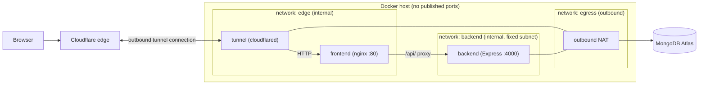

# Operations

Deployment, runtime configuration and maintenance of Mei's Community Library. The REST contract lives in [system-contract.md](system-contract.md); local development setup is in the [README](../README.md). Everything below is derived from `docker-compose.yml`, the Dockerfiles, `frontend/nginx*.conf`, `.env.example`, `package.json`, the tooling configs and `backend/src`.

Hostnames in examples (`library.example.com`) are placeholders.

## 1. Deployment topology

Three Compose services: `tunnel` (`cloudflare/cloudflared`), `frontend` (nginx serving the built SPA and proxying `/api/`) and `backend` (Express, API only). MongoDB is external (for example MongoDB Atlas); it is not part of the Compose file.



### Networks

| Network   | Flags in compose                                             | Members                                                                   | Purpose                                                                |
| --------- | ------------------------------------------------------------ | ------------------------------------------------------------------------- | ---------------------------------------------------------------------- |
| `edge`    | `internal: true`                                             | `tunnel`, `frontend`                                                      | Tunnel to nginx. No external connectivity.                             |
| `backend` | `internal: true`, subnet `${BACKEND_SUBNET:-172.29.46.0/24}` | `frontend` (fixed IPv4 `${FRONTEND_BACKEND_IP:-172.29.46.10}`), `backend` | nginx to API. No external connectivity.                                |
| `egress`  | default (not internal)                                       | `tunnel`, `backend`                                                       | Outbound only: `tunnel` reaches Cloudflare, `backend` reaches MongoDB. |

- No service declares `ports:`; nothing is published on the host. The only ingress path is the outbound Cloudflare Tunnel connection started by `tunnel run` with `TUNNEL_TOKEN`.
- The public-hostname-to-origin mapping of the tunnel is not defined in this repository. The origin must be the nginx service, which listens on port 80 (`frontend:80` on the `edge` network).
- `backend` is not on `edge`, so the tunnel cannot reach the API directly; `/api/` traffic always passes through nginx.
- `backend` is on `egress` because it must reach MongoDB. It is the only service besides `tunnel` with outbound access.

### Start order

`tunnel` waits for `frontend` to be healthy; `frontend` waits for `backend` to be healthy (`depends_on.condition: service_healthy`). Because the backend healthcheck requires HTTP 200 from `/api/health`, which requires a live MongoDB connection (see [Healthchecks](#3-healthchecks)), the stack does not come up fully while MongoDB is unreachable.

### Why `TRUST_PROXY` must match the fixed edge IP

Compose sets the backend's `TRUST_PROXY` to `${FRONTEND_BACKEND_IP:-172.29.46.10}`, which is the address nginx has on the `backend` network (`frontend.networks.backend.ipv4_address`). In `backend/src/app.ts` the value is parsed by `parseTrustedProxies` (`backend/src/config/trust-proxy.ts`) and passed to Express `trust proxy`. Express then honours `X-Forwarded-For` and `X-Forwarded-Proto` only from that address.

- nginx writes the real client IP into `X-Forwarded-For` (see [nginx](#4-nginx)); the backend derives `req.ip` from it, and `getClientKey` (`backend/src/utils/http/client-ip.ts`) uses `req.ip` as the key for the auth rate limits.
- If `TRUST_PROXY` does not include nginx's actual address, Express ignores the forwarded headers and `req.ip` becomes the nginx address. All clients then share one rate-limit key.
- If `TRUST_PROXY` is unset, no `trust proxy` setting is applied at all.
- That is why the IP is pinned: nginx's address on the `backend` network must be predictable. `BACKEND_SUBNET` and `FRONTEND_BACKEND_IP` must be changed together (`.env.example`: "must stay in sync"); the IP must lie inside the subnet.
- `TRUST_PROXY` accepts a comma-separated list of explicit IPs or CIDRs. Anything else (hostnames, `true`, `loopback`, a `/0` prefix, prefix above 32/128) throws `TRUST_PROXY must contain explicit IP addresses or CIDR ranges.` and the process exits at startup.

## 2. Docker images

All images use `node:22-alpine` for build stages. The build context is the repository root (`context: .`); `.dockerignore` excludes `.env*` (except `.env.example`), `node_modules`, `dist`, `dist-server`, `data`, `.git`, test files (`**/*.test.*`, `**/*.spec.*`), `docs`, `README.md`, `docker-compose.yml` and Dockerfiles.

### `backend/Dockerfile`

| Stage     | Base             | What it does                                                                                                                                                                                                                                                                                                                  |
| --------- | ---------------- | ----------------------------------------------------------------------------------------------------------------------------------------------------------------------------------------------------------------------------------------------------------------------------------------------------------------------------- |
| `builder` | `node:22-alpine` | `npm ci --ignore-scripts` (all dependencies), copies `tsconfig.json`, `backend`, `shared`; runs esbuild twice (`--bundle --platform=node --format=esm --target=node22 --packages=external`) producing `dist-server/server.mjs` (from `backend/src/index.ts`) and `dist-server/seed.mjs` (from `backend/src/scripts/seed.ts`). |
| `deps`    | `node:22-alpine` | `npm ci --omit=dev --ignore-scripts`. Production dependencies only (`dotenv`, `express`, `mongoose`).                                                                                                                                                                                                                         |
| `runtime` | `node:22-alpine` | Sets `NODE_ENV=production`, `API_ONLY=true`, `PORT=4000`; copies `node_modules` from `deps`, `dist-server` from `builder`, and `package.json` (it carries `"type": "module"`). Runs as `USER node`, `EXPOSE 4000`, `CMD ["node", "dist-server/server.mjs"]`.                                                                  |

`--packages=external` keeps dependencies out of the bundle; they are resolved from the `node_modules` copied from `deps`.

### `frontend/Dockerfile`

| Stage     | Base                                      | What it does                                                                                                                                                                                                                                                |
| --------- | ----------------------------------------- | ----------------------------------------------------------------------------------------------------------------------------------------------------------------------------------------------------------------------------------------------------------- |
| `builder` | `node:22-alpine`                          | `npm ci --ignore-scripts`, copies `tsconfig.json`, `shared`, `frontend/index.html`, `frontend/vite.config.ts`, `frontend/public`, `frontend/src`; runs `npm run build` (Vite, output `frontend/dist`).                                                      |
| final     | `nginxinc/nginx-unprivileged:1.27-alpine` | Copies `frontend/nginx-security-headers.conf` to `/etc/nginx/snippets/security-headers.conf`, `frontend/nginx.conf` to `/etc/nginx/conf.d/default.conf`, and `frontend/dist` to `/usr/share/nginx/html`. `EXPOSE 80`, `CMD ["nginx", "-g", "daemon off;"]`. |

### Why `npm ci --ignore-scripts`

`npm ci` installs exactly the versions in `package-lock.json` and fails if `package.json` and the lockfile disagree. `--ignore-scripts` prevents dependency lifecycle scripts (`preinstall`, `install`, `postinstall`) from running during the image build. The build stages call esbuild/Vite binaries directly, so no install scripts are invoked.

### Dev-only dependencies

`backend/src/config/frontend.ts` imports `vite` dynamically only when `NODE_ENV !== 'production'`. The production image has no Vite, and `npm start` (which uses `tsx`, a devDependency) is not what the container runs.

## 3. Healthchecks

| Service    | Check                                                                                                          | Timing                                                |
| ---------- | -------------------------------------------------------------------------------------------------------------- | ----------------------------------------------------- |
| `backend`  | `node -e "fetch('http://127.0.0.1:4000/api/health')..."`; exits 0 when the response is `ok` (2xx), otherwise 1 | interval 15s, timeout 5s, retries 5, start_period 15s |
| `frontend` | `wget -qO- http://127.0.0.1:80/index.html >/dev/null \|\| exit 1`                                              | interval 15s, timeout 5s, retries 3, start_period 5s  |
| `tunnel`   | none defined                                                                                                   |                                                       |

`GET /api/health` (`backend/src/controllers/health.controller.ts`):

| Condition                                             | Status | Body `status` / `connected` |
| ----------------------------------------------------- | ------ | --------------------------- |
| MongoDB `readyState === 1` (after `ensureDatabase()`) | `200`  | `ok` / `true`               |
| Not connected                                         | `503`  | `degraded` / `false`        |

- The response always carries `Cache-Control: no-store`, `service`, `storage`, `timestamp`. The `database` field is included only when `NODE_ENV` is not `production`.
- Each probe calls `ensureDatabase()`, which attempts a reconnect when disconnected. Attempts are throttled by a 5 s cooldown (`RECONNECT_COOLDOWN_MS`) after a failure; the connect attempt itself uses `serverSelectionTimeoutMS: 8000`.
- A backend that cannot reach MongoDB therefore becomes `unhealthy`, which blocks `frontend` and `tunnel` from starting under `depends_on`.

## 4. nginx

Configuration: `frontend/nginx.conf` (server) and `frontend/nginx-security-headers.conf` (snippet).

### Client IP and forwarded headers

```text
geo $remote_addr $is_trusted_tunnel   127.0.0.1/32, ::1/128, 10.0.0.0/8, 172.16.0.0/12, 192.168.0.0/16 -> 1; default 0
map "$is_trusted_tunnel:$http_cf_connecting_ip" $client_ip   "1:<value>" -> <value>; otherwise $remote_addr
map $http_x_forwarded_proto $forwarded_proto                 empty -> $scheme; otherwise passthrough
```

| Upstream header to backend | Value                                                           |
| -------------------------- | --------------------------------------------------------------- |
| `X-Real-IP`                | `$client_ip`                                                    |
| `X-Forwarded-For`          | `$client_ip` (replaces any client-supplied chain; not appended) |
| `X-Forwarded-Proto`        | `$forwarded_proto`                                              |
| `Host`                     | `$http_host`                                                    |

- `CF-Connecting-IP` is trusted only when the direct peer (`$remote_addr`) is loopback or private RFC 1918 space (which includes the Docker bridge networks). A request from a public address cannot spoof the client IP through that header.
- The client IP is therefore the `CF-Connecting-IP` value when traffic arrives through the tunnel, else the peer address.
- `X-Forwarded-Proto` is passed through when present, otherwise set to the scheme nginx saw (`http`, since nginx listens on port 80 only).

### Routing and limits

| Location                                                                             | Behaviour                                                                                                                                                                                                                                                                                                                   |
| ------------------------------------------------------------------------------------ | --------------------------------------------------------------------------------------------------------------------------------------------------------------------------------------------------------------------------------------------------------------------------------------------------------------------------- |
| `= /api`                                                                             | `404` with `{"error":"API endpoint not found."}`                                                                                                                                                                                                                                                                            |
| `/api/`                                                                              | `proxy_pass http://backend:4000` (HTTP/1.1, `Connection ""`); `proxy_connect_timeout 5s`, `proxy_send_timeout 30s`, `proxy_read_timeout 30s`; backend `X-Content-Type-Options` and `Referrer-Policy` headers are hidden so nginx's copies are the only ones; `413` is mapped to `{"error":"Request payload is too large."}` |
| `= /index.html`, `= /theme-init.js`, `/` (SPA fallback `try_files $uri /index.html`) | `Cache-Control: no-cache`                                                                                                                                                                                                                                                                                                   |
| `^~ /assets/`                                                                        | `Cache-Control: public, max-age=31536000, immutable`; `try_files $uri =404`                                                                                                                                                                                                                                                 |
| `^~ /src/assets/`                                                                    | `Cache-Control: public, max-age=86400`; `try_files $uri =404`                                                                                                                                                                                                                                                               |

Server-level settings: `client_max_body_size 1100k` (Express separately limits JSON bodies to `1mb` in `backend/src/app.ts`), `server_tokens off`, `absolute_redirect off`, `resolver 127.0.0.11 ipv6=off valid=30s` (Docker DNS; `backend` is resolved at request time via a variable in `proxy_pass`), gzip for `text/plain`, `text/css`, `application/javascript`, `application/json`, `image/svg+xml` above 1024 bytes.

### Security headers

Defined in `frontend/nginx-security-headers.conf`, all with `always`, and re-included in every `location` that sets its own `add_header` (nginx does not inherit `add_header` into a block that defines its own).

| Header                      | Value                                      |
| --------------------------- | ------------------------------------------ |
| `X-Frame-Options`           | `DENY`                                     |
| `X-Content-Type-Options`    | `nosniff`                                  |
| `Referrer-Policy`           | `strict-origin-when-cross-origin`          |
| `Permissions-Policy`        | `camera=(), microphone=(), geolocation=()` |
| `Strict-Transport-Security` | `max-age=31536000; includeSubDomains`      |
| `Content-Security-Policy`   | see below                                  |

Content-Security-Policy directives:

| Directive         | Sources                                               |
| ----------------- | ----------------------------------------------------- |
| `default-src`     | `'self'`                                              |
| `script-src`      | `'self'`                                              |
| `style-src`       | `'self' 'unsafe-inline' https://fonts.googleapis.com` |
| `font-src`        | `'self' https://fonts.gstatic.com data:`              |
| `img-src`         | `'self' data: blob: https:`                           |
| `connect-src`     | `'self'`                                              |
| `frame-ancestors` | `'none'`                                              |
| `base-uri`        | `'self'`                                              |
| `form-action`     | `'self'`                                              |
| `object-src`      | `'none'`                                              |

`script-src 'self'` forbids inline scripts, which is why the theme bootstrap is a separate file (`frontend/public/theme-init.js`, served at `/theme-init.js`).

The backend itself also sets `X-Content-Type-Options: nosniff` and `Referrer-Policy: strict-origin-when-cross-origin` (`security-headers.middleware.ts`), and `Cache-Control: no-store` on authenticated routes and `/api/health`.

## 5. Container hardening

Only options present in `docker-compose.yml`:

| Option                                 | `backend`                                 | `frontend`                                | `tunnel`         |
| -------------------------------------- | ----------------------------------------- | ----------------------------------------- | ---------------- |
| `restart`                              | `unless-stopped`                          | `unless-stopped`                          | `unless-stopped` |
| `init: true`                           | yes                                       | yes                                       | yes              |
| `read_only: true`                      | yes                                       | yes                                       | yes              |
| `cap_drop: [ALL]`                      | yes                                       | yes                                       | yes              |
| `security_opt: no-new-privileges:true` | yes                                       | yes                                       | yes              |
| `tmpfs`                                | `/tmp`                                    | `/tmp`, `/var/cache/nginx`, `/var/run`    | `/tmp`           |
| `mem_limit`                            | `512m`                                    | `128m`                                    | `128m`           |
| `pids_limit`                           | `128`                                     | `128`                                     | `128`            |
| `logging`                              | `json-file`, `max-size 10m`, `max-file 3` | same                                      | same             |
| `sysctls`                              | none                                      | `net.ipv4.ip_unprivileged_port_start: 80` | none             |

- No `user:` is set in the compose file. The backend image sets `USER node`; the frontend base image is `nginx-unprivileged`. The tunnel service uses the upstream image's default user (not configured here).
- The `ip_unprivileged_port_start: 80` sysctl lets the non-root nginx bind port 80 with all capabilities dropped.
- The tunnel image is pinned to a fixed tag (`cloudflare/cloudflared:2026.11.1` in the compose file); update the tag deliberately.
- With `read_only: true`, the application cannot write outside the tmpfs mounts. The backend writes no files (state is in MongoDB).

## 6. Environment variables

Read by the stack (`.env.example`, `docker-compose.yml`, `backend/src`). Compose reads `.env` from the project directory for `${...}` interpolation.

| Variable                                                  | Used by       | Required                                             | Default / behaviour                                                                                                                                                                                                                                                                                |
| --------------------------------------------------------- | ------------- | ---------------------------------------------------- | -------------------------------------------------------------------------------------------------------------------------------------------------------------------------------------------------------------------------------------------------------------------------------------------------- |
| `MONGODB_URI`                                             | backend, seed | Yes (compose aborts with `MONGODB_URI is required`)  | Must start with `mongodb://` or `mongodb+srv://` and must not contain the placeholders `MY_MONGODB_URI`, `<db_username>`, `<db_password>`, `<password>`, `<cluster-host>`; otherwise treated as not configured.                                                                                    |
| `MONGODB_DB_NAME`                                         | backend, seed | No                                                   | Used only when the URI has no database path; default `meis_community_library`. Compose passes an empty string when unset.                                                                                                                                                                          |
| `JWT_SECRET`                                              | backend       | Yes (compose aborts with `JWT_SECRET is required`)   | At least 32 bytes (UTF-8). In production a shorter or missing value throws at startup. Outside production an ephemeral random secret is used.                                                                                                                                                      |
| `SETUP_TOKEN`                                             | backend       | Only while creating the first administrator          | At least 32 characters. Compose passes an empty string when unset.                                                                                                                                                                                                                                 |
| `TRUST_PROXY`                                             | backend       | Set by compose                                       | Comma-separated IPs/CIDRs. Compose sets it to `${FRONTEND_BACKEND_IP:-172.29.46.10}`.                                                                                                                                                                                                              |
| `FRONTEND_BACKEND_IP`                                     | compose       | No                                                   | Default `172.29.46.10`; nginx's fixed address on `backend`, also the backend's `TRUST_PROXY`.                                                                                                                                                                                                      |
| `BACKEND_SUBNET`                                          | compose       | No                                                   | Default `172.29.46.0/24`.                                                                                                                                                                                                                                                                          |
| `TUNNEL_TOKEN`                                            | tunnel        | Yes (compose aborts with `TUNNEL_TOKEN is required`) | Cloudflare Tunnel token.                                                                                                                                                                                                                                                                           |
| `PORT`                                                    | backend       | No                                                   | Compose sets `4000`. `.env.example` defaults to `3000` for local runs; invalid/zero values fall back to `3000` (`Number(process.env.PORT) \|\| 3000`). The server binds `0.0.0.0`.                                                                                                                 |
| `API_ONLY`                                                | backend       | No                                                   | `true` disables static/Vite frontend serving. Compose and the backend image set it.                                                                                                                                                                                                                |
| `NODE_ENV`                                                | backend       | No                                                   | Compose and the image set `production`. Controls setup-token enforcement, JWT secret enforcement, generic 503 message, `Secure` on cookies, and the `database` health field.                                                                                                                       |
| `LIBRARIAN_EMAIL`, `LIBRARIAN_NAME`, `LIBRARIAN_PASSWORD` | backend       | No                                                   | Environment-based librarian override (`env-admin-session.store.ts`); active when `LIBRARIAN_PASSWORD` is set (`.env.example`: at least 8 characters). **Not forwarded by `docker-compose.yml`**, so they have no effect inside the Compose stack unless added to the backend `environment:` block. |

## 7. First run

Prerequisites: a MongoDB deployment with transactions (replica set or Atlas), a Cloudflare Tunnel token, and `.env` kept private (`chmod 600 .env`, as in the README).

1. Create `.env` from `.env.example` and set:
   - `MONGODB_URI` (see [MongoDB Atlas](#8-mongodb-atlas)).
   - `JWT_SECRET`: at least 32 bytes, stable across restarts and replicas. Generate with, for example, `openssl rand -base64 48`.
   - `TUNNEL_TOKEN`.
   - `SETUP_TOKEN`: at least 32 characters, for example `openssl rand -hex 32`.
2. Build and start:

   ```bash
   docker compose up --build -d
   docker compose ps          # all three services should reach "healthy"/running
   ```

3. Create the first administrator. In production `POST /api/auth/setup` requires `X-Setup-Token` equal to `SETUP_TOKEN` and the CSRF header `X-Requested-With: XMLHttpRequest`:

   ```bash
   curl -X POST https://library.example.com/api/auth/setup \
     -H 'Content-Type: application/json' \
     -H 'X-Requested-With: XMLHttpRequest' \
     -H "X-Setup-Token: $SETUP_TOKEN" \
     --data '{"name":"Librarian","email":"librarian@example.com","password":"replace-with-a-strong-password"}'
   ```

   Success is `201 Created`. A second call after setup completes returns `409`. Setup attempts are rate-limited (10 per 15 minutes per client key).

4. Remove `SETUP_TOKEN` from `.env` and recreate the backend so it no longer holds the token:

   ```bash
   docker compose up -d backend
   ```

   After removal the setup endpoint cannot be used in production: with `NODE_ENV=production` a missing or shorter-than-32-character `SETUP_TOKEN` yields `403 Setup is not authorized.`

5. Optional sample data (12 books, 3 lendings, per the README). Run inside the container; this inserts without deleting existing data:

   ```bash
   docker compose exec backend node dist-server/seed.mjs
   ```

   Append `--reset` to wipe existing catalog and lending data first (`process.argv.includes('--reset')`). Use it only when that loss is intended. The seed exits with code 1 and a sanitized message if `MONGODB_URI` is unconfigured or the connection fails.

## 8. MongoDB Atlas

- **Network Access:** allowlist the public egress IP of the Docker host (the address the `backend` container's outbound traffic leaves from), not `0.0.0.0/0`. The backend's own connection-failure message tells operators to do this: "allowlist the deployment's egress IP address in MongoDB Atlas Network Access". Only `backend` (and the seed script run through it) connects to MongoDB; `tunnel` has no database access need.
- **Database user:** credentials go only in `MONGODB_URI`. Connection errors are logged with the URI replaced by `[redacted-mongodb-uri]` (`sanitizeConnectionError`).
- **Transactions are required.** Lending create/return and other multi-document writes use `mongoose.startSession().withTransaction(...)` (`mongo-library.repository.ts`). On a standalone server the API responds `503` `Database transactions require a MongoDB replica set.` Atlas clusters are replica sets; a local server needs a replica set (`?replicaSet=rs0` in the URI, per `.env.example`).
- **Database name:** taken from the URI path if present; else `MONGODB_DB_NAME`; else `meis_community_library`.
- **Login rate-limit storage:** attempts are stored in the database (collection `auth_login_attempts`, per the README), so replicas share limits. If automatic index creation is disabled, the README gives the TTL index command: `db.auth_login_attempts.createIndex({ resetAt: 1 }, { expireAfterSeconds: 0 })`.

## 9. Secrets and rotation

Secrets: `MONGODB_URI`, `JWT_SECRET`, `SETUP_TOKEN`, `TUNNEL_TOKEN`, `LIBRARIAN_PASSWORD`. `.env` and `.env.*` (except `.env.example`) are excluded by both `.gitignore` and `.dockerignore`; Compose injects secrets at runtime, so they are not baked into images.

Checklist:

- [ ] `.env` is not tracked by git and is mode `600`; `.env.example` contains no real values.
- [ ] `JWT_SECRET` is at least 32 bytes, random, and identical across all backend replicas and restarts.
- [ ] `SETUP_TOKEN` is removed from the environment after the first administrator is created.
- [ ] Atlas Network Access lists only the egress IP, not `0.0.0.0/0`.
- [ ] Atlas database user has only the privileges the application needs on its database.

Rotation:

| Secret                    | Procedure                                                                                                               | Effect                                                                               |
| ------------------------- | ----------------------------------------------------------------------------------------------------------------------- | ------------------------------------------------------------------------------------ |
| `JWT_SECRET`              | Set the new value, `docker compose up -d backend`.                                                                      | Access tokens (15 min lifetime, HS256) signed with the old secret fail verification. |
| `MONGODB_URI` credentials | Change the Atlas database user's password (or create a new user), update `MONGODB_URI`, `docker compose up -d backend`. | Backend reconnects with the new credentials; until then `/api/health` is `503`.      |
| `TUNNEL_TOKEN`            | Issue a new token for the tunnel in Cloudflare, update `.env`, `docker compose up -d tunnel`.                           | Brief public outage while the tunnel restarts.                                       |
| `SETUP_TOKEN`             | Only needed during setup; generate a fresh one if setup must be repeated, then remove it.                               | None after removal.                                                                  |

## 10. npm scripts

| Script         | Command                                                                                             | Purpose                                                                                                                                                                             |
| -------------- | --------------------------------------------------------------------------------------------------- | ----------------------------------------------------------------------------------------------------------------------------------------------------------------------------------- |
| `dev`          | `tsx backend/src/index.ts`                                                                          | Express API plus Vite dev middleware (HMR) on `PORT` (default 3000). Loads `.env` through `dotenv/config`.                                                                          |
| `start`        | `NODE_ENV=production tsx backend/src/index.ts`                                                      | Production mode without Docker: serves `frontend/dist` with Express static plus SPA fallback unless `API_ONLY=true`. Requires `npm run build` first and `JWT_SECRET` (>= 32 bytes). |
| `build`        | `vite build --config frontend/vite.config.ts`                                                       | Builds the frontend into `frontend/dist`; also copies `frontend/src/assets` to `dist/src/assets`.                                                                                   |
| `preview`      | `vite preview --config frontend/vite.config.ts`                                                     | Serves the built frontend; `/api` is proxied to `http://127.0.0.1:${PORT or 3000}`.                                                                                                 |
| `seed`         | `tsx backend/src/scripts/seed.ts`                                                                   | Seeds sample data; `npm run seed -- --reset` wipes first.                                                                                                                           |
| `test`         | `tsx --test 'backend/src/tests/*.test.ts' 'frontend/src/**/*.test.ts' 'frontend/src/**/*.test.tsx'` | Node test runner via tsx.                                                                                                                                                           |
| `clean`        | `rm -rf frontend/dist dist dist-server`                                                             | Removes build output.                                                                                                                                                               |
| `typecheck`    | `tsc --noEmit`                                                                                      | Type-checks the project per `tsconfig.json`.                                                                                                                                        |
| `lint`         | `eslint backend/src frontend/src frontend/vite.config.ts shared`                                    | ESLint.                                                                                                                                                                             |
| `lint:fix`     | same with `--fix`                                                                                   | ESLint autofix.                                                                                                                                                                     |
| `format`       | `prettier --write .`                                                                                | Formats the repository (respects `.prettierignore`).                                                                                                                                |
| `format:check` | `prettier --check .`                                                                                | Fails on unformatted files.                                                                                                                                                         |

## 11. Tooling configuration

| Tool       | File                             | Summary                                                                                                                                                                                                                                                                                                                                                                                                                                                                           |
| ---------- | -------------------------------- | --------------------------------------------------------------------------------------------------------------------------------------------------------------------------------------------------------------------------------------------------------------------------------------------------------------------------------------------------------------------------------------------------------------------------------------------------------------------------------- |
| TypeScript | `tsconfig.json`                  | `target ES2022`, `strict`, `module ESNext`, `moduleResolution bundler`, `jsx react-jsx`, `isolatedModules`, `allowJs`, `noEmit`, `types: ["vite/client"]`, `skipLibCheck`; path alias `@shared/*` to `./shared/*`; excludes `dist`, `frontend/dist`, `dist-server`. TypeScript is for checking only; builds use esbuild/Vite.                                                                                                                                                     |
| ESLint     | `eslint.config.js` (flat config) | Ignores `dist/**`, `frontend/dist/**`, `dist-server/**`, `node_modules/**`, `*.log`. `@eslint/js` recommended; `@babel/eslint-parser` with `@babel/preset-react` (automatic runtime) and `@babel/preset-typescript`. Rules: `no-unused-vars` as warning (`args: none`, ignoring names matching `^[A-Z]` or `^_`), `no-undef` off. For `frontend/src/**/*.{ts,tsx}`: `eslint-plugin-react` recommended rules with `react-in-jsx-scope` and `prop-types` off, React version `19.3`. |
| Prettier   | `.prettierrc`                    | `semi: true`, `singleQuote: true`, `trailingComma: es5`, `tabWidth: 2`, `printWidth: 90`. `.prettierignore`: `dist/`, `frontend/dist/`, `dist-server/`, `node_modules/`, `package-lock.json`, `*.log`.                                                                                                                                                                                                                                                                            |

## 12. Graceful shutdown

`backend/src/config/shutdown.ts` handles `SIGTERM` and `SIGINT`: stops accepting connections, closes idle connections, disconnects Mongoose and exits `0`; a 10 s timer forces exit code `1` if shutdown stalls. `init: true` in Compose forwards signals to the Node process.

## 13. Troubleshooting

| Symptom                                                                                                               | Cause (source)                                                                                                           | Fix                                                                                                                                                                                         |
| --------------------------------------------------------------------------------------------------------------------- | ------------------------------------------------------------------------------------------------------------------------ | ------------------------------------------------------------------------------------------------------------------------------------------------------------------------------------------- |
| `docker compose` aborts with `MONGODB_URI is required`, `JWT_SECRET is required` or `TUNNEL_TOKEN is required`        | `:?` interpolation guards in `docker-compose.yml`                                                                        | Set the variable in `.env`.                                                                                                                                                                 |
| Backend exits at start; log `Failed to start server:` with `JWT_SECRET must contain at least 32 bytes in production.` | `getJwtSecret()` is called in `createApiApp`                                                                             | Set `JWT_SECRET` to at least 32 bytes.                                                                                                                                                      |
| Backend exits at start with `TRUST_PROXY must contain explicit IP addresses or CIDR ranges.`                          | `parseTrustedProxies`                                                                                                    | Use only IPs/CIDRs, comma-separated.                                                                                                                                                        |
| `/api/health` returns `503` / backend `unhealthy` / frontend and tunnel never start                                   | MongoDB not connected                                                                                                    | Check backend logs for `[Library DB]` lines. Verify `MONGODB_URI`, Atlas Network Access (egress IP) and DB user. Retries are throttled to one per 5 s with an 8 s server-selection timeout. |
| Log: `MONGODB_URI is not configured yet...`                                                                           | URI empty, lacks `mongodb://`/`mongodb+srv://`, or still contains a placeholder (`<db_username>`, `<cluster-host>`, ...) | Replace the placeholder with a real connection string.                                                                                                                                      |
| Log: `Could not connect to MongoDB Atlas (...)`                                                                       | Connection or authentication failure, or IP not allowlisted                                                              | Allowlist the egress IP; check credentials. The URI is redacted in the message.                                                                                                             |
| API returns `503` `Database service is currently unavailable.`                                                        | `requireDatabase` in production hides the detailed reason                                                                | Read the backend log for the real cause.                                                                                                                                                    |
| API returns `503` `Database transactions require a MongoDB replica set.`                                              | Lending operations need transactions                                                                                     | Use Atlas or a replica set.                                                                                                                                                                 |
| `POST /api/auth/setup` returns `403` `Setup is not authorized.`                                                       | In production the backend `SETUP_TOKEN` is unset or shorter than 32 characters, or `X-Setup-Token` does not match        | Set a 32+ character `SETUP_TOKEN` in the backend environment and send the same value.                                                                                                       |
| `403` `Missing required request header.`                                                                              | `X-Requested-With: XMLHttpRequest` absent on a state-changing auth route                                                 | Add the header.                                                                                                                                                                             |
| `403` `Cross-origin request rejected.` / `Cross-site request rejected.`                                               | `Origin`/`Referer` host differs from `Host`, or `Sec-Fetch-Site: cross-site`                                             | Call the API from the same origin. nginx forwards `Host` unchanged, so the public hostname must be the one in `Origin`.                                                                     |
| `409` on setup                                                                                                        | An administrator already exists                                                                                          | Log in instead.                                                                                                                                                                             |
| `429` on login or setup                                                                                               | Auth rate limit (window 15 min: setup 10; login 15 per IP and 10 per IP+email; password change 10)                       | Wait for the window to expire. If everyone is limited at once, check `TRUST_PROXY` matches nginx's address (see [topology](#why-trust_proxy-must-match-the-fixed-edge-ip)).                 |
| `413` `Request payload is too large.`                                                                                 | Body above nginx `client_max_body_size 1100k`                                                                            | Reduce the payload. Express itself rejects above `1mb` with `Request body is too large.`                                                                                                    |
| `404` `API endpoint not found.`                                                                                       | Unknown `/api/...` path (nginx for bare `/api`, Express otherwise)                                                       | Check the path against [system-contract.md](system-contract.md).                                                                                                                            |
| Network creation fails on `docker compose up` (address overlap)                                                       | Default `172.29.46.0/24` clashes with an existing network                                                                | Set `BACKEND_SUBNET` and `FRONTEND_BACKEND_IP` (inside the subnet) in `.env`.                                                                                                               |
| Client rate limits all collapse to one IP                                                                             | `TRUST_PROXY` differs from `FRONTEND_BACKEND_IP`                                                                         | They default to the same value; keep them in sync.                                                                                                                                          |
| `LIBRARIAN_*` variables ignored in Docker                                                                             | Not listed in the compose `backend.environment`                                                                          | Add them to that block if the override is wanted.                                                                                                                                           |

Useful commands:

```bash
docker compose logs -f backend
docker compose ps
docker compose exec backend node dist-server/seed.mjs
```

## 14. Upgrades

- Rebuild and recreate: `docker compose up --build -d`. Compose recreates containers whose image or configuration changed.
- `restart: unless-stopped` plus the healthcheck dependency chain brings `frontend` and `tunnel` back after the backend becomes healthy.
- Pin changes to the `cloudflared` image tag in `docker-compose.yml`; the Node and nginx bases track `node:22-alpine` and `nginxinc/nginx-unprivileged:1.27-alpine`.
- The repository defines no backup, restore or migration tooling. Data lives only in MongoDB; use Atlas-provided backups or `mongodump` outside this project.

## Known discrepancies

- `.env.example` documents `LIBRARIAN_EMAIL`, `LIBRARIAN_NAME` and `LIBRARIAN_PASSWORD`, but `docker-compose.yml` does not pass them to the `backend` service, so they are ineffective under Compose as shipped.
