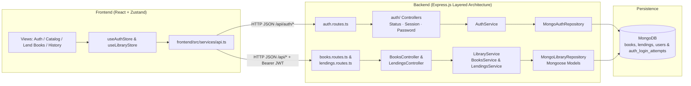
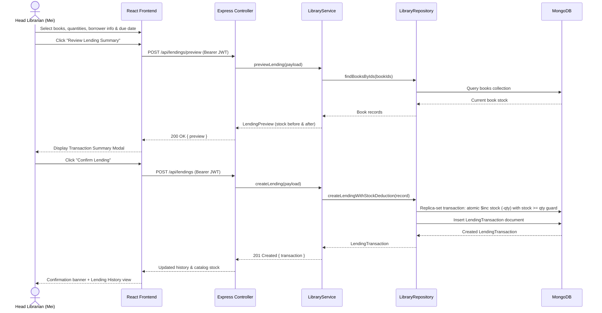
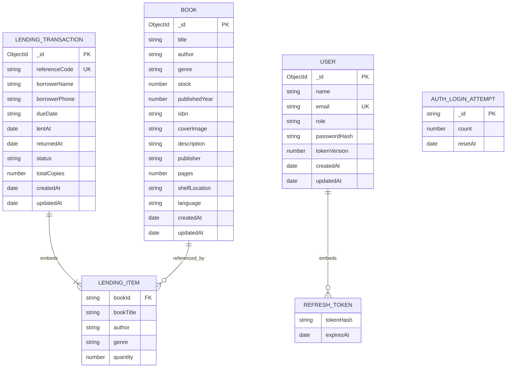

# Mei's Community Library — System & API Contract

This document defines the service architecture, layer boundaries, data schema, and REST API contract between the React frontend and Express backend.

## 1. System Architecture & Service Relations



## 2. Multi-Book Lending Transaction Sequence



## 3. Data Model (ER Diagram)



## 4. Authentication & Request Headers

- **Bearer JWT (`Authorization: Bearer <accessToken>`)**: Required on all `/api/genres`, `/api/books*`, `/api/lendings*`, `GET /api/auth/me`, and `PATCH /api/auth/password` requests. Signed with HS256 (15-minute TTL) using `JWT_SECRET` (at least 32 bytes in production).
- **Refresh Cookie (`mcl_refresh`)**: `HttpOnly; SameSite=Lax; Path=/api/auth` (plus `Secure` in production/HTTPS), 7-day TTL, rotated on `POST /api/auth/refresh`.
- **CSRF Protection (`X-Requested-With: XMLHttpRequest`)**: Required on all state-changing auth routes (`POST /api/auth/setup`, `POST /api/auth/login`, `POST /api/auth/refresh`, `POST /api/auth/logout`, `PATCH /api/auth/password`). When an `Origin` header is present, its host must match `Host`.
- **Setup Token (`X-Setup-Token`)**: Required on `POST /api/auth/setup` in production (or whenever `SETUP_TOKEN` is set; must be at least 32 characters).
- **Cache Control**: Authenticated endpoints, auth responses, and `/api/health` return `Cache-Control: no-store`.

## 5. REST API Contract

Base path: `/api` · Content-Type: `application/json`

### Health & Authentication

| Method  | Endpoint             | Auth / Headers                                      | Purpose                                                           | Success Status   |
| :------ | :------------------- | :-------------------------------------------------- | :---------------------------------------------------------------- | :--------------- |
| `GET`   | `/api/health`        | Public                                              | Service health & MongoDB connectivity (`503` when disconnected)   | `200 OK` / `503` |
| `GET`   | `/api/auth/status`   | Public                                              | DB status, `needsSetup`, `requiresSetupToken`, `hasSessionCookie` | `200 OK`         |
| `POST`  | `/api/auth/setup`    | `X-Requested-With`; `X-Setup-Token` in production   | Create initial administrator account and start session            | `201 Created`    |
| `POST`  | `/api/auth/login`    | `X-Requested-With`                                  | Verify librarian credentials (rate-limited) and issue session     | `200 OK`         |
| `POST`  | `/api/auth/refresh`  | `X-Requested-With` + `mcl_refresh` cookie           | Rotate refresh cookie and mint a new access token                 | `200 OK`         |
| `POST`  | `/api/auth/logout`   | `X-Requested-With` (optional cookie / Bearer token) | Revoke active session tokens and clear `mcl_refresh` cookie       | `200 OK`         |
| `GET`   | `/api/auth/me`       | `Authorization: Bearer <accessToken>`               | Return authenticated librarian profile                            | `200 OK`         |
| `PATCH` | `/api/auth/password` | `Authorization: Bearer` + `X-Requested-With`        | Update password, bump `tokenVersion`, and issue a rotated session | `200 OK`         |

### Catalog & Lending (All Require `Authorization: Bearer <accessToken>`)

| Method   | Endpoint                   | Purpose                                                                | Success Status |
| :------- | :------------------------- | :--------------------------------------------------------------------- | :------------- |
| `GET`    | `/api/genres`              | List distinct sorted genres in inventory                               | `200 OK`       |
| `GET`    | `/api/books`               | List books (`?genre=&sortBy=title\|stock&sortOrder=asc\|desc&search=`) | `200 OK`       |
| `GET`    | `/api/books/:id`           | Fetch a single book record by ID                                       | `200 OK`       |
| `POST`   | `/api/books`               | Add a new book to inventory                                            | `201 Created`  |
| `PATCH`  | `/api/books/:id`           | Update a book; stock changes require its original `expectedStock`      | `200 OK`       |
| `DELETE` | `/api/books/:id`           | Remove a book from inventory                                           | `200 OK`       |
| `GET`    | `/api/lendings`            | List lending transaction history (newest first)                        | `200 OK`       |
| `POST`   | `/api/lendings/preview`    | Validate lending input and compute pre-confirmation summary            | `200 OK`       |
| `POST`   | `/api/lendings`            | Confirm multi-book lending and deduct library stock                    | `201 Created`  |
| `PATCH`  | `/api/lendings/:id/return` | Mark an active loan as returned and restore book stock                 | `200 OK`       |

### Key Payload Schemas

#### `POST /api/books`

```json
{
  "title": "The Midnight Library",
  "author": "Matt Haig",
  "genre": "Fiction",
  "stock": 5,
  "publishedYear": 2020,
  "isbn": "978-0525559474",
  "coverImage": "/src/assets/images/cover_botanical_fiction_1795275512139.jpg",
  "description": "Between life and death there is a library of infinite alternate lives.",
  "publisher": "Canongate Books",
  "pages": 304,
  "shelfLocation": "Aisle A · Shelf 2",
  "language": "English"
}
```

All fields after `stock` are optional. For `PATCH /api/books/:id`, include
`expectedStock` with `stock`; the server returns `409` if another operation
changed the stock since it was read. An update that omits `stock` does not
change inventory and does not require `expectedStock`.

#### `POST /api/lendings/preview` & `POST /api/lendings`

```json
{
  "borrowerName": "Rina Kusuma",
  "borrowerPhone": "+62 812-3456-7890",
  "dueDate": "2026-12-10",
  "items": [
    { "bookId": "673f...", "quantity": 2 },
    { "bookId": "673f...", "quantity": 1 }
  ]
}
```

#### Auth Session Response (`POST /api/auth/setup`, `login`, `refresh`, `PATCH /api/auth/password`)

```json
{
  "user": {
    "id": "673f...",
    "name": "Mei Lin",
    "email": "mei@communitylibrary.org",
    "role": "admin",
    "canChangePassword": true
  },
  "accessToken": "<hs256-jwt>",
  "expiresInSeconds": 900
}
```

#### `GET /api/health` Response (`200 OK` when connected, `503 Service Unavailable` when disconnected)

```json
{
  "status": "ok",
  "service": "Mei's Community Library API",
  "storage": "mongodb",
  "connected": true,
  "timestamp": "2026-11-22T01:00:00.000Z"
}
```

In non-production environments, `database` is also included with the active database name.

#### Standard Error Responses

Error codes: `400` (validation / malformed JSON), `401` (authentication required or invalid/expired credentials/tokens), `403` (missing `X-Requested-With`, cross-origin rejection, or invalid `X-Setup-Token`), `404` (resource or endpoint not found), `409` (stock conflict or setup already completed), `413` (payload exceeds 1 MB Express limit or 1100 KB Nginx limit), `415` (unsupported encoding/charset), `429` (login rate limit exceeded), `500` (unexpected server error), `503` (MongoDB unavailable).

```json
{
  "error": "Not enough stock for \"The Hobbit\". Available: 2, requested: 3.",
  "fieldErrors": {
    "items": "Insufficient stock for \"The Hobbit\" (2 available)."
  }
}
```
